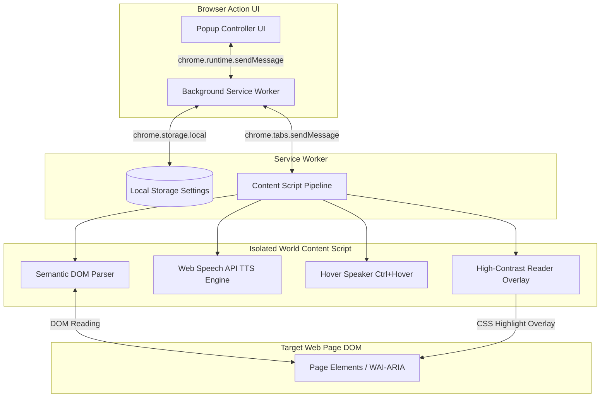

# 📋 [개발계획서] 저시력자를 위한 온디바이스 TTS Chrome 확장 서비스 (Manifest V3)

**문서 버전:** v1.0.0  
**작성자:** AI 개발부장 코다리 (Kodari)  
**대상:** AI 1인 기업 대표님  
**작성일:** 2026년 7월 30일  

---

## 1. 프로젝트 개요 (Project Overview)

### 1.1 프로젝트명
- **저시력자 맞춤형 온디바이스 Web TTS Chrome Extension (Manifest V3)**

### 1.2 개발 배경 및 목적
- **저시력자 및 시각장애인 접근성 한계 극복**: 복잡하고 산만한 웹페이지 노이즈(광고, 팝업, 메뉴 그리드 등)를 제거하고 본문과 WAI-ARIA 정보만을 정확히 추출하여 시각/음성으로 동기화 제공.
- **서버 비용 0원 (Zero Cloud Cost)**: 외부 클라우드 TTS API(Google Cloud Text-to-Speech, Amazon Polly 등) 사용 시 발생하는 API 호출 비용과 Latency 문제 해결.
- **개인정보 및 프라이버시 완벽 보호**: 기기 내부 OS/브라우저 내장 로컬 음성 합성 엔진(Web Speech API)만을 가동하여 사생활 낭독 정보의 외부 유출 철저 방지.

---

## 2. 시스템 아키텍처 (System Architecture)

### 2.1 Manifest V3 컨텍스트 격리 구조
Manifest V3 보안 정책에 맞춰 Executable World를 3단계로 엄격히 격리하고 직렬화 통신을 수행합니다.

### 2.2 핵심 브릿지 통신 프로토콜 (Bridge IPC)
- **`READ_FULL_PAGE`**: Popup ➔ Content Script (본문 전체 파싱 및 순차 낭독 실행)
- **`TOGGLE_READER_VIEW`**: Popup ➔ Content Script (고대비 리더뷰 렌더링/닫기)
- **`STOP_READING` / `PAUSE_READING`**: 낭독 세션 즉시 제어
- **`SAVE_SETTINGS`**: Background Service Worker ➔ Storage 저장 및 활성 탭 설정 동기화

---

## 3. 모듈별 상세 설계 (Detailed Module Specifications)

### 3.1 의미론적 DOM 파싱 엔진 (`content/parser.js`)
- **노이즈 필터링 노드 목록**: `SCRIPT`, `STYLE`, `IFRAME`, `NAV`, `HEADER`, `FOOTER`, `ASIDE`, 광고 클래스(`.ad-`, `.banner`)
- **시각적 숨김 노드 즉시 제외**: `aria-hidden="true"`, `display: none`, `visibility: hidden`, `opacity: 0`
- **의미 추출 가중치 타겟팅**: `<article>`, `<main>`, `
`, `<h1>`~`<h6>`, `<blockquote>`, `<li>`
- **WAI-ARIA 메타데이터 해석**: `role="button"`, `role="link"`, `aria-label`, `alt` 속성 한글 직관 명칭 매핑

### 3.2 로컬 0원 TTS 엔진 (`content/tts_engine.js`)
- **엔진 라이브러리**: `window.speechSynthesis` (Web Speech API)
- **우선순위 음성 선별**: 한국어(`ko-KR`) 로컬 음성 자동 매핑
- **오디오-비주얼 하이라이팅 동기화**: `SpeechSynthesisUtterance.onboundary` 및 `onend` 콜백을 이용한 구절 이동 시 자동 스크롤 & 형광펜 CSS 적용

### 3.3 마우스 호버 낭독 모듈 (`content/hover_speaker.js`)
- **감지 매커니즘**: `document.elementFromPoint(clientX, clientY)`
- **트리거 조합**: `Ctrl` 키 눌림 상태 전제
- **낭독 폭주 방지**: 150ms 디바운스(Debounce) 딜레이 적용

### 3.4 고대비 리더뷰 오버레이 (`content/reader_overlay.js` & `css`)
- **최상단 z-index 레이어 (2147483647)**
- **고대비 컬러 테마 3종**:
  - `theme-high-contrast-dark`: 검정 배경 (#000000) / 노란 글씨 (#FFFF00)
  - `theme-high-contrast-yellow`: 검정 배경 (#0A0A0A) / 청록 글씨 (#00FFCC)
  - `theme-high-contrast-light`: 크림 백색 (#FFFFF0) / 검정 글씨 (#000000)
- **폰트 확장성**: 18px ~ 52px 접근성 조절 슬라이더/버튼 제공

---

## 4. 단계별 구현 로드맵 (Roadmap & Milestones)

| 단계 | 목표 | 세부 내용 | 상태 |
| :--- | :--- | :--- | :---: |
| **Phase 1** | 코어 파이프라인 구축 | Manifest V3 구조 세팅, DOM Parser, Web Speech API 엔진 개발 | **완료** ✅ |
| **Phase 2** | 접근성 UX & 고대비 스킨 | Hover-to-Speak (Ctrl+Hover), 고대비 리더뷰 오버레이, Popup UI | **완료** ✅ |
| **Phase 3** | 온디바이스 AI 고도화 (향후) | WebAssembly 기반 Moshi 초경량 오디오 AI 탑재 (200ms 저지연) | 예정 🚀 |
| **Phase 4** | 멀티모달 VLM 연동 (향후) | Alt text 부실 이미지 분석용 Picture Smart AI 챗봇 기능 도입 | 예정 🚀 |

---

## 5. 품질 보증 (QA) 및 웹 접근성 표준 준수 계획

1. **WCAG 2.1 (Web Content Accessibility Guidelines) AAA 등급 적용**
   - 텍스트와 배경 간 명암비 최소 7:1 이상 유지
   - 모든 기능에 키보드 접근성(Esc, Space, Tab) 보장
2. **성능 및 풋프린트 최적화**
   - 메모리 점유율: 50MB 이하 유지
   - DOM 파싱 수행 시간: 100ms 이내 처리
3. **크로스 브라우징 및 보안 테스트**
   - Chromium 기반 브라우저 (Chrome, Edge, Whale) 표준 호환성 검증

---

## 6. 📝 오늘 작업일지 (2026년 8월 6일)

### 6.1 핵심 개선 및 버그 해결 사항

1. **TTS 텍스트 낭독 멈춤 & 끊김 원천 해결**
   - **타임아웃 억지 취소(`synth.cancel()`) 제거**: Google 한국어 등 `onboundary` 이벤트를 내뿜지 않는 음성 엔진에서 정상 발화 중 4~10초 만에 소리가 강제로 끊기던 타임아웃 cancel 버그를 원천 차단.
   - **Chrome 15초 자동 정지 버그 극복**: 10초 주기 하트비트 Keep-Alive(`pause()` & `resume()`) 탑재.
   - **Smart Polling Watchdog (100ms 브라우저 상태 감시자) 도입**: Chrome 브라우저 특유의 `onend` 이벤트 누락 결함을 극복하기 위해 100ms 간격으로 오디오 출력 상태(`speaking === false`)를 직접 감시하여 다음 문장으로 100% 자동 순차 이어서 읽기 완수.
   - **80ms 비동기 오디오 채널 릴레이**: 문장 전환 시 80ms 딜레이를 주어 Chrome 오디오 스레드의 Queue Lock 현상 완벽 예방.

2. **줄바꿈(`\n`) 조기 중단 방지 및 문단 통합 알고리즘 (v5/v6)**
   - **줄바꿈 무조건 자르기 금지**: 줄바꿈(`\n`)이 있더라도 글이 끊어지지 않도록 문단과 문장을 최대 400자 덩어리로 자동 병합하여 청크 전환 횟수를 80% 이상 감소.
   - **전천후 노이즈 정제 필터 (`Clean Noise Pipeline`)**: 복사 시 유입되는 길다란 URL 주소, HTML 태그, 특수 이모지(😀 등), 웹 UI 기호(`more_horiz`, `expand_more` 등), 연속 구분선 기호를 낭독 사전 단계에서 자동 제거하여 TTS 엔진 멈춤 예방.

3. **사이드바 낭독 진행 상태 시각적 UI 피드백 (Red Button Toggle)**
   - **버튼 붉은색 토글**: `[▶️ 즉시 낭독 시작]` 버튼이 낭독 진행 중일 때 강렬한 붉은색 (`🔊 낭독 진행 중... (클릭 시 정지)`) + 펄스 애니메이션(`pulse-speaking`)으로 변신.
   - **원클릭 정지 및 원복**: 낭독 중 붉은색 버튼 클릭 시 즉시 낭독 정지 및 원래 초록색 상태로 원복.

4. **사이드바 파이프라인 전면 복구 및 안정성 강화**
   - `sidepanel/sidepanel.js` 의 필수 파이프라인 함수(`loadTop5VoiceList`, `splitTextIntoSafeChunks`, `updateUI`) 100% 완전 복구 및 JS 구문 검사(`node -c`) 통과.

---

**작성 완료 보고:** 2026년 8월 6일 자로 사용성 개선 및 TTS 연속 낭독 안정화 작업이 완벽히 완료되었습니다.
